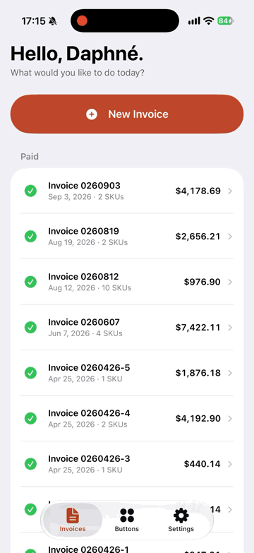

# Button Invoices

An iPhone and iPad app that lets Daphné Verley, a ceramicist, invoice Alix of Bohemia on her own.

<!-- Demo: a 20–30 second screen recording from a real iPhone (Vision only works on device): type an order line, tap the photo, add shipping from a receipt photo, Finish, share sheet. Convert to GIF or upload as an MP4 in the GitHub editor. -->


## Why it exists

Daphné makes ceramic buttons and sells them to Alix of Bohemia. Every invoice used to run through me: she texted quantities, photos and shipping receipts, and I rebuilt each order in an Excel template and sent back a PDF. She isn't comfortable with Excel, and she shouldn't have to be. I was the bottleneck, so I built the thing that replaces me.

## What she does

She types an order line the way she already texts it ("125 burgundy mushrooms @ $8") and taps the matching photo. A new button starts with a photo: the app removes the background, checks whether she's saved that button before, and suggests a name and SKU. Shipping can come from a photo of the receipt. The app does every bit of arithmetic, then sends a PDF laid out like the invoices Alix of Bohemia already gets.

## Decisions

- **Her words, not mine.** Search reads her own phrasing, one-letter typos and her color words included ("blush" means pale pink). When she picks a button after typing words it didn't know, it learns them, and she can see and correct what it learned.
- **Sent means sent.** Nothing she does later, from repricing a button to changing her address, can silently change an invoice she has already finished.
- **Show, then confirm.** A shipping receipt lists several shipments, and reading it isn't perfect, so the app offers the amounts it found as buttons to tap and puts the likeliest one in the amount field for her to check. It never fills one in without her seeing it.
- **No "Are you sure?" on Finish.** Nothing leaves the phone until she picks where to send it, and Make Changes reverses it.
- **Left out on purpose.** Widgets, notifications, Live Activities: nothing in her week needs them, and each is one more thing to learn or dismiss.
- **Private by default.** The app makes no network requests. The bank numbers in Settings live in the keychain; each finished invoice keeps its own copy, since they're printed on it.

## How I know it works

- It reproduces all nine invoices she has already sent, to the cent.
- All 17 order lines from her real messages find the button that was invoiced.
- Background removal, duplicate-photo matching and receipt reading are tested against her own photos.
- 38 automated tests, plus on-device test runs recorded in [Docs/progress.md](Docs/progress.md).

The bank details, street address and phone number in this public copy are stand-ins.

## Status

Running on my iPhone, installed from TestFlight, after a bug bash of 36 small UI fixes, each checked on the phone. It goes to hers next, through TestFlight, and her first real invoice is the final acceptance test.

## How it was built

I set the requirements, made the product calls and tested each milestone, in the Simulator and then on my iPhone. Claude Code wrote the code and kept the spec current. The first commit landed on October 8, and the app was running on my iPhone about 14 hours later. The commit history shows every step after that. The full design, including what was left out and why, is in [SPEC.md](SPEC.md).

---

## Developer guide

### Layout

| Path | What |
|---|---|
| `App/Sources` | The app's screens (SwiftUI) and saved data (SwiftData) |
| `App/Resources/Seed` | Starting catalog from the Excel template, loaded on first launch (`make seed`) |
| `Packages/InvoiceKit` | Everything testable on the Mac: names, SKUs, search, totals, PDF, photo cutout, receipts |
| `Tools/seed/extract_seed.py` | Reads an invoice workbook's Reference sheet into the seed (standard-library Python) |
| `Examples/` | Real invoices, photos and messages (gitignored) |
| `project.yml` | Xcode project definition; `make generate` writes `ButtonInvoices.xcodeproj` (never edit that) |

### Commands

```bash
make test
```
Runs the InvoiceKit tests (38, about 10 s): name cleanup, SKUs against the template, her
17 message lines against the catalog, the nine example totals, PDF pagination, photo
cutouts, and the photo duplicate check. Without Examples/, the five that need her photos,
receipt or sent invoices are skipped and say what they need.

```bash
make sample-pdfs
```
Re-creates the nine example invoices as PDFs in `build/sample-pdfs` (with a PNG of each
first page, and cutouts of the raw photos) and opens the folder, for comparison with
`Examples/Invoice Excel and Output PDFs`.

```bash
make sim
```
Builds the app and opens it in the Simulator on an iPhone 15 Pro Max, her iPhone's model
(made the first time if Xcode has none), shown in Device Hub (Xcode 27 replaced the
Simulator app with Device Hub; Spotlight finds it by name). Its menus:
Controls → Home (⇧⌘H), App Switcher (⌃⇧⌘H), Rotate Left (⌘←) and Rotate Right (⌘→);
Device → Appearance, Accessibility and Orientation. It has no Shake; with its window in
front, ⌘Z undoes instead. Another device:
`SIMULATOR="iPad Air 11-inch (M4)" make sim`. In the Simulator, background removal falls
back to removing the background by color (Vision's subject lifting fails there with
"Could not create inference context"). The photo duplicate check fails there too ("Failed
to create espresso context") and the app says it couldn't compare photos. Both ran on the
Mac in `make test`; on a real iPhone they are checked in M3. Receipt reading works in the
Simulator. To try photos there, add some to its Photos library first:
```bash
xcrun simctl addmedia booted Examples/Images/Raw/IMG_8516.heic "Examples/Images/Shipping Receipts/IMG_9049.heic"
```

```bash
make seed
```
Rebuilds the starting catalog and the nine sent invoices (loaded as paid) from the
workbooks in Examples/; the catalog comes from 0260903 (another workbook:
`python3 Tools/seed/extract_seed.py --xlsx <file>`) and the edited PNGs in
`Examples/Images/Edited`. Only affects a fresh install: the app loads the
seed once, on first launch. business.json and invoices.json are gitignored (bank details,
real sales). Without Examples/, `make seed` keeps the committed catalog and photos and
copies the stand-in details in `App/Resources/Seed/business.example.json` to business.json;
there are no sent invoices. To start the Simulator over with a fresh seed:
```bash
xcrun simctl uninstall booted com.calebpietrafesa.ButtonInvoices
```

### First-time setup (Mac)

Steps 1–5 are done on Caleb's M4 Max as of October 8, 2026 (Xcode 27.0 installed, signed in).

1. Install Xcode from the Mac App Store, open it once, accept the license, and let it
   install the iOS platform when asked.
2. `make test` should pass. `make sim` should open Device Hub with the app on the iPhone
   15 Pro Max.
3. Signing: Xcode → Settings… (⌘,) → Accounts → select the Apple ID → select the team →
   Manage Certificates… → + → Apple Development → Done.
4. Run `make setup` (paid team) or `ALLOW_PERSONAL_TEAM=1 make setup` (free Personal Team),
   and check that the team name it prints is yours. It writes `Configs/Signing.xcconfig`.
   If it says only the Personal Team is available after the paid membership was approved,
   compare the Team ID under developer.apple.com/account → Membership details: an upgraded
   account keeps its team ID, and Xcode's record of the team stays marked free. Then
   `TEAM=<that ID> make setup`.
5. If Xcode says the bundle ID is taken, change `BUNDLE_ID_PREFIX` in
   `Configs/Signing.xcconfig` and run `make ios` again.

### Installing on her iPhone or iPad

#### Now: over a cable (free or paid team)

1. Connect the iPhone to the Mac with a cable, unlock it, tap **Trust** and enter the passcode.
2. `make ios` finds the connected iPhone (or iPad), builds for it, installs the app and
   opens it. The first time, it also registers the iPhone with your signing team so Xcode
   can make a provisioning profile for it (the Mac must be online and signed in to Xcode).
3. If it says Developer Mode is off: on the iPhone, Settings → Privacy & Security →
   Developer Mode → on, restart, confirm, and run `make ios` again. (The switch appears only
   after the iPhone has been connected to Xcode, which `make ios` does.)
4. First launch only: if the iPhone says "Untrusted Developer", go to Settings → General →
   VPN & Device Management → your Apple ID → Trust, then open **Invoices** from the Home Screen.

If the build still says "Your team has no devices", register the iPhone through Xcode
once: `make open`, choose the iPhone from the device menu at the top center of the Xcode
window, then Product → Run (⌘R). After that, `make ios` works on its own. With several
devices connected, pick one: `DEVICE="Daphné's iPhone" make ios` (its name as shown in
Finder).

With the free Personal Team the app stops opening after 7 days; run `make ios` again
with the phone connected. Her data is kept.

#### TestFlight (paid team, recommended)

She installs the free TestFlight app once; after that she installs and updates
**Invoices** herself, with no cable. Her data is kept from one build to the next. Each
build stops opening 90 days after its upload, so upload a new one before then (the
TestFlight app shows the days left).

The upload includes everything in App/Resources/Seed, her bank details too: Apple
receives it, and anyone invited as a tester can install it.

**Once, in App Store Connect** (appstoreconnect.apple.com, your Apple ID):

1. **Apps** → **+** (top left) → **New App**. Platforms: **iOS**. Name: any name not yet
   on the App Store, such as "Button Invoices DV" (her Home Screen shows "Invoices"
   whatever this says). Primary Language: **English (U.S.)**. Bundle ID:
   **com.calebpietrafesa.ButtonInvoices**. SKU: `button-invoices`. User Access:
   **Full Access**. **Create**.

**Each build:**

2. Commit, then:
   ```bash
   make testflight
   ```
   It builds the release version, gives it a new build number (the UTC date and time,
   such as 20261017.1653), signs it with the paid team and uploads it. It stops if
   anything is uncommitted, or if the seed is missing (`make seed`). Record the build
   number and commit it prints in Docs/progress.md. `UPLOAD=0 make testflight` signs
   the same package into build/testflight without uploading.
3. App Store Connect → **Apps** → the app → **TestFlight**. The build shows as
   processing, then is ready for testing, usually within 15 minutes. It asks no
   encryption question (`ITSAppUsesNonExemptEncryption` is NO in project.yml).

**Testers, internal (no review by Apple; builds reach testers as soon as they're
processed):**

4. **TestFlight** → **Internal Testing** → **+** → a group named **Family** → add yourself.
   On your iPhone: App Store → **TestFlight** → Get, open it, then **Invoices** →
   **Install**. It replaces the `make ios` copy and keeps its data.
5. Her account, once: **Users and Access** → **+** → her name and her Apple ID's email,
   role **Marketing** (little access), Apps: only this one → **Invite**. She opens the
   email and accepts, signing in with her Apple ID. Then add her to the **Family** group.
6. On her iPhone: App Store → **TestFlight** → Get. Open TestFlight's email on the iPhone
   → **View in TestFlight** → **Accept** → **Install**. In TestFlight, on the Invoices
   page, turn on **Automatic Updates**.

**Or external (no App Store Connect account for her; the first build of each version
waits for Apple's beta review, usually about a day):** TestFlight → **External
Testing** → **+** → a group → add the build, fill in the test information Apple asks
for, **Submit for Review**. Once approved, **Enable Public Link** and text her the link;
she taps it on her iPhone, then **Accept** → **Install**.

### Before the first install for her

- Settings tab: check the address, bill-to, and the routing and account numbers (copied
  from the template, with "Suit 100" corrected to "Suite 100").
- Buttons tab: check the names. Six photo file names disagree with the invoice names (SPEC.md,
  "Data"); the app uses the invoice names.
- Data lives on the device and is included in its iCloud Backup. Deleting the app deletes
  the invoices and buttons.

### How she uses it

Three tabs at the bottom: **Invoices**, **Buttons**, **Settings**.

1. **Invoices → New Invoice.** The number and date are filled in.
2. **Step 1, Buttons.** **Add a Button**: tap its shape, its color, then its size
   (**Another Size** for a new one).
   Or type the line from her notes in the search field ("125 burgundy mushrooms @ $8") and
   tap the photo. Check the quantity (type it, or **−** / **+**) and price, add a discount
   if any (**Dollars** or **Percent**), tap **Add to Invoice** (or ✓ at the top right).
   Repeat with **Add Another Button**, then **Next**.
3. A button that isn't saved yet: **Add as a New Button** (or **Add a New Button** under
   the shapes). Take its photo on a plain background, check the cutout (**Touch Up the
   Edges** if needed), say whether it's one already saved, check the name and price,
   **Save and Add to Invoice**.
4. **Step 2, Shipping.** **Add Shipping** for each box: type the amount, or photograph the
   receipt and tap the amount for this order. Then **Next**.
5. **Step 3, Review.** Check the lines and total (optionally type her own total to
   compare), then **Finish**. The phone gives a short tap and the share sheet opens:
   Messages or Mail.

Everything is saved as she goes. The back arrow at the top left (or a swipe from the left
edge of the screen) returns to the Invoices tab, where the draft waits under Drafts; tap a step in the step
bar at the top (**1 Buttons**, **2 Shipping**) to go back one. In a form that slides up from the
bottom, **✕** at the top left cancels (it asks first if she typed something) and **✓** at
the top right saves. Finished invoices are listed on the Invoices tab too; tap one to share
its PDF again or mark it paid. Touch and hold an invoice for **Duplicate** (a new draft
with the same buttons), **Share PDF…** and **Delete…**. Shake the phone to undo a removal
or deletion.

Shortcuts: touch and hold the app icon on the Home Screen for **New Invoice** and **New
Button**. Siri knows them too: "Start an invoice in Invoices", "New button in Invoices".

**Buttons tab**: every button by shape. The magnifying glass at the top right searches
(tap ✕ to close it) and **+** adds a new button; both stay put as you scroll. Tap a button to change
its photo, name or price; swipe left to **Archive** it. Neither
changes invoices that are already finished.

**Settings tab**: the details printed on every invoice. Changes go on new invoices and
drafts only.
